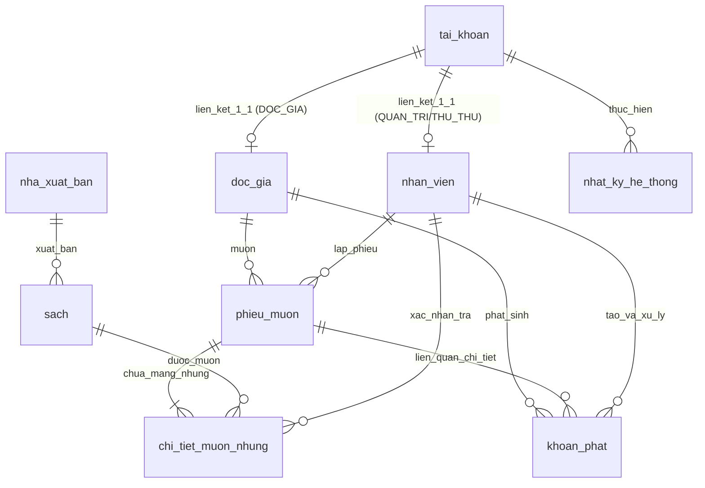

# DB.md — Thiết kế Cơ sở Dữ liệu MongoDB & Hướng dẫn Khởi tạo

> **Dự án:** WEBQUANLYMUONSACH — Website quản lý thư viện và nghiệp vụ mượn trả sách
>
> **Hệ quản trị CSDL:** MongoDB (kết hợp Node.js + Express.js)
>
> **Căn cứ thiết kế:** `PROJECT.md` (v1.0) và lược đồ CSDL mẫu (`NHAXUATBAN`, `SACH`, `THEODOIMUONSACH`, `DOCGIA`, `NhanVien`)
>
> **Quy ước định danh:** Toàn bộ tên collection, tên trường (field) và giá trị enum đều dùng **tiếng Việt không dấu**.

## 1. Quy ước đặt tên và ánh xạ từ lược đồ mẫu

### 1.1. Quy ước đặt tên (Tiếng Việt không dấu)

| Thành phần | Quy ước | Ví dụ |
| :--- | :--- | :--- |
| Tên Collection | `snake_case`, tiếng Việt không dấu | `tai_khoan`, `doc_gia`, `phieu_muon` |
| Tên trường (Field) | `camelCase`, tiếng Việt không dấu | `maDocGia`, `ngayMuon`, `hanTra`, `soQuyenKhaDung` |
| Giá trị Enum | `UPPER_SNAKE_CASE`, tiếng Việt không dấu | `QUAN_TRI`, `THU_THU`, `DANG_MUON`, `DA_TRA_TRE` |
| Khóa chính nội bộ | `_id` (`ObjectId`) mặc định của MongoDB | `_id` |
| Mã nghiệp vụ | `String` có `unique index`, giữ sát lược đồ mẫu | `maDocGia`, `maSach`, `maNXB`, `msnv` |
| Khóa ngoại tham chiếu | `<tenThucThe>Id` (`ObjectId`) | `taiKhoanId`, `nhaXuatBanId`, `docGiaId` |

### 1.2. Ánh xạ từ 5 thực thể mẫu sang 9 Collection MongoDB

| Thực thể mẫu | Collection MongoDB | Ghi chú mở rộng theo `PROJECT.md` |
| :--- | :--- | :--- |
| `NHAXUATBAN` | `nha_xuat_ban` | Giữ `maNXB`, `tenNXB`, `diaChi`; bổ sung trạng thái ngừng hoạt động (soft delete) và thông tin truy vết. |
| `SACH` | `sach` | Giữ `maSach`, `tenSach`, `donGia`, `namXuatBan`, `nguonGocTacGia`; tách `SOQUYEN` thành bộ 4 số lượng (`tongSoQuyen`, `soQuyenDangMuon`, `soQuyenHuHong`, `soQuyenKhaDung`) và tham chiếu `nhaXuatBanId`. |
| `DOCGIA` | `doc_gia` + `tai_khoan` | Giữ `maDocGia`, `hoLot`, `ten`, `ngaySinh`, `phai`, `diaChi`, `dienThoai`; tách tài khoản đăng nhập sang `tai_khoan`, tách riêng `trangThaiQuyenMuon`. |
| `NhanVien` | `nhan_vien` + `tai_khoan` | Giữ `msnv`, `hoTenNV`, `chucVu`, `diaChi`, `soDienThoai`; chuyển `Password` sang `tai_khoan.matKhauHash` (đã băm) để quản lý tập trung 3 vai trò. |
| `THEODOIMUONSACH` | `phieu_muon` (nhúng `chiTietMuon`) | Một phiếu mượn chứa nhiều đầu sách; mỗi cuốn sách là một phần tử trong mảng `chiTietMuon` có `hanTra`, `ngayTraThucTe` và `trangThai` riêng để hỗ trợ trả từng phần. |
| *(Mở rộng)* | `khoan_phat` | Quản lý phạt trả trễ, bồi thường sách hư hỏng/mất và trạng thái thanh toán. |
| *(Mở rộng)* | `nhat_ky_he_thong` | Ghi vết mọi thao tác nghiệp vụ quan trọng (ai làm, làm gì, khi nào, lý do). |
| *(Mở rộng)* | `cau_hinh_thu_vien` | Lưu tập trung các chính sách mượn trả (nhất là các mục đang `PENDING DECISION`) để tránh hard-code. |

## 2. Chiến lược Nhúng (Embedded) và Tham chiếu (Referenced)

| Mối quan hệ | Chiến lược | Lý do kỹ thuật (Truy vấn & Tính nhất quán) |
| :--- | :--- | :--- |
| `phieu_muon` ↔ `chiTietMuon` | **Nhúng (Embedded)** | Một phiếu mượn có số lượng sách giới hạn nhỏ (đề xuất 5 cuốn — `PENDING DECISION`), luôn được đọc/cập nhật cùng phiếu khi lập phiếu hoặc trả từng phần. Nhúng giúp cập nhật trạng thái chi tiết và trạng thái phiếu (`DANG_MO` → `HOAN_TAT`) trong một thao tác nguyên tử. Mỗi phần tử vẫn có `_id` riêng để `khoan_phat` tham chiếu chính xác từng cuốn. |
| `chiTietMuon` ↔ `lichSuGiaHan` | **Nhúng (Embedded)** | Số lần gia hạn trên mỗi cuốn rất ít (đề xuất tối đa 1 lần — `PENDING DECISION`), luôn hiển thị kèm chi tiết mượn. |
| `chiTietMuon` → thông tin sách lúc mượn | **Snapshot nhúng nhẹ** | Lưu kèm `maSach`, `tenSach`, `donGiaTaiThoiDiemMuon` để bảo toàn lịch sử và làm căn cứ tính bồi thường mất/hư hỏng nếu giá sách thay đổi về sau. |
| `tai_khoan` ↔ `doc_gia` / `nhan_vien` | **Tham chiếu 1-1 (`ObjectId`)** | Tách biệt bảo mật xác thực (mật khẩu băm, khóa đăng nhập) khỏi dữ liệu hồ sơ nghiệp vụ. Ràng buộc `unique` trên `taiKhoanId` đảm bảo không có hồ sơ trùng tài khoản và dùng transaction khi đăng ký để tránh tài khoản mồ côi. |
| `sach` → `nha_xuat_ban` | **Tham chiếu N-1 (`ObjectId`)** | Một nhà xuất bản có nhiều đầu sách; tham chiếu tránh lặp dữ liệu khi cập nhật tên/địa chỉ NXB và dễ kiểm tra ràng buộc cấm xóa NXB đang có sách. |
| `khoan_phat` → `doc_gia`, `phieu_muon` | **Tham chiếu (`ObjectId`)** | Độc giả có thể thanh toán hoặc được miễn phạt độc lập sau khi phiếu mượn đã đóng; cần truy vấn danh sách phạt chưa thanh toán trên toàn hệ thống. |
| `nhat_ky_he_thong` | **Collection riêng** | Dữ liệu nhật ký tăng trưởng liên tục không giới hạn theo thời gian (unbounded growth), không được nhúng vào tài liệu nghiệp vụ. |

## 3. Sơ đồ quan hệ tổng thể (ERD)



## 4. Đặc tả chi tiết 9 Collection

### 4.1. Collection `tai_khoan`

Lưu thông tin xác thực, phân quyền và trạng thái đăng nhập cho cả 3 vai trò.

| Trường | Kiểu dữ liệu | Bắt buộc | Mô tả & Ràng buộc |
| :--- | :--- | :---: | :--- |
| `_id` | `ObjectId` | Có | Khóa chính nội bộ |
| `tenDangNhap` | `String` | Có | Duy nhất (`unique`), viết thường, không khoảng trắng |
| `email` | `String` | Không | Duy nhất nếu có giá trị (`unique`, `sparse`), dùng hỗ trợ liên hệ/khôi phục |
| `matKhauHash` | `String` | Có | Mật khẩu đã băm (bcrypt/argon2), tuyệt đối không lưu văn bản thuần |
| `vaiTro` | `String` (Enum) | Có | `QUAN_TRI`, `THU_THU`, `DOC_GIA` |
| `trangThai` | `String` (Enum) | Có | `HOAT_DONG`, `BI_KHOA`, `CHO_XAC_MINH` (`CHO_XAC_MINH` tùy chính sách — `PENDING DECISION`) |
| `lyDoKhoa` | `String` | Không | Lý do khóa tài khoản (khi `trangThai = BI_KHOA`) |
| `ngayKhoa` | `Date` | Không | Thời điểm khóa tài khoản |
| `nguoiKhoaId` | `ObjectId` | Không | Tham chiếu `tai_khoan._id` của người khóa |
| `lanDangNhapCuoi` | `Date` | Không | Thời điểm đăng nhập thành công gần nhất |
| `ngayDoiMatKhauCuoi` | `Date` | Không | Thời điểm đổi mật khẩu gần nhất |
| `ngayTao` | `Date` | Có | Thời điểm tạo tài khoản |
| `ngayCapNhat` | `Date` | Có | Thời điểm cập nhật gần nhất |

**Indexes:** `{ tenDangNhap: 1 }` (`unique`), `{ email: 1 }` (`unique, sparse`), `{ vaiTro: 1, trangThai: 1 }`.

### 4.2. Collection `doc_gia`

Lưu hồ sơ cá nhân và quyền mượn sách của độc giả (tách biệt với trạng thái đăng nhập trong `tai_khoan`).

| Trường | Kiểu dữ liệu | Bắt buộc | Mô tả & Ràng buộc |
| :--- | :--- | :---: | :--- |
| `_id` | `ObjectId` | Có | Khóa chính nội bộ |
| `taiKhoanId` | `ObjectId` | Có | Tham chiếu `tai_khoan._id` (`unique`), chỉ liên kết tài khoản có `vaiTro = DOC_GIA` |
| `maDocGia` | `String` | Có | Mã độc giả duy nhất (ánh xạ `DOCGIA.MADOCGIA`), ví dụ `DG0001` |
| `hoLot` | `String` | Có | Họ và tên lót (ánh xạ `DOCGIA.HOLOT`) |
| `ten` | `String` | Có | Tên (ánh xạ `DOCGIA.TEN`) |
| `ngaySinh` | `Date` | Không | Ngày sinh (ánh xạ `DOCGIA.NGAYSINH`) |
| `phai` | `String` (Enum) | Không | `NAM`, `NU`, `KHAC` (ánh xạ `DOCGIA.PHAI`) |
| `diaChi` | `String` | Không | Địa chỉ (ánh xạ `DOCGIA.DIACHI`) |
| `dienThoai` | `String` | Có | Số điện thoại (ánh xạ `DOCGIA.DIENTHOAI`); ràng buộc `unique` phụ thuộc chính sách (`PENDING DECISION`) |
| `trangThaiQuyenMuon` | `String` (Enum) | Có | `DUOC_MUON`, `BI_HAN_CHE` (BR-04: bị hạn chế mượn vẫn đăng nhập tra cứu được) |
| `lyDoHanCheMuon` | `String` | Không | Lý do hạn chế quyền mượn (quá hạn, nợ phạt...) |
| `soSachDangMuon` | `Number` | Có | Mặc định `0`, `>= 0`. Số cuốn hiện đang mượn để kiểm tra nhanh giới hạn mượn (BR-06) |
| `tongTienPhatChuaTra` | `Number` | Có | Mặc định `0`, `>= 0`. Tổng số tiền phạt còn nợ chưa thanh toán |
| `trangThaiHoSo` | `String` (Enum) | Có | `HOAT_DONG`, `NGUNG_HOAT_DONG` (soft delete theo BR-11) |
| `nguoiTaoId` | `ObjectId` | Không | Tham chiếu `tai_khoan._id` |
| `nguoiCapNhatId` | `ObjectId` | Không | Tham chiếu `tai_khoan._id` |
| `ngayTao` | `Date` | Có | Thời điểm tạo hồ sơ |
| `ngayCapNhat` | `Date` | Có | Thời điểm cập nhật gần nhất |

**Indexes:** `{ taiKhoanId: 1 }` (`unique`), `{ maDocGia: 1 }` (`unique`), `{ dienThoai: 1 }`, `{ hoLot: 1, ten: 1 }`, `{ trangThaiQuyenMuon: 1, trangThaiHoSo: 1 }`.

### 4.3. Collection `nhan_vien`

Lưu hồ sơ nhân viên thư viện và quản trị viên.

| Trường | Kiểu dữ liệu | Bắt buộc | Mô tả & Ràng buộc |
| :--- | :--- | :---: | :--- |
| `_id` | `ObjectId` | Có | Khóa chính nội bộ |
| `taiKhoanId` | `ObjectId` | Có | Tham chiếu `tai_khoan._id` (`unique`), liên kết tài khoản `QUAN_TRI` hoặc `THU_THU` |
| `msnv` | `String` | Có | Mã số nhân viên duy nhất (ánh xạ `NhanVien.MSNV`), ví dụ `NV001` |
| `hoTenNV` | `String` | Có | Họ tên nhân viên (ánh xạ `NhanVien.HoTenNV`) |
| `chucVu` | `String` | Có | Chức vụ hiển thị (ánh xạ `NhanVien.ChucVu`), ví dụ `Quan tri vien`, `Thu thu` |
| `diaChi` | `String` | Không | Địa chỉ (ánh xạ `NhanVien.DiaChi`) |
| `soDienThoai` | `String` | Có | Số điện thoại (ánh xạ `NhanVien.SoDienThoai`) |
| `trangThaiLamViec` | `String` (Enum) | Có | `DANG_LAM_VIEC`, `NGHI_VIEC` (bảo toàn vết lịch sử, không xóa vật lý) |
| `nguoiTaoId` | `ObjectId` | Không | Tham chiếu `tai_khoan._id` |
| `nguoiCapNhatId` | `ObjectId` | Không | Tham chiếu `tai_khoan._id` |
| `ngayTao` | `Date` | Có | Thời điểm tạo |
| `ngayCapNhat` | `Date` | Có | Thời điểm cập nhật gần nhất |

**Indexes:** `{ taiKhoanId: 1 }` (`unique`), `{ msnv: 1 }` (`unique`), `{ trangThaiLamViec: 1 }`.

### 4.4. Collection `nha_xuat_ban`

Lưu thông tin nhà xuất bản.

| Trường | Kiểu dữ liệu | Bắt buộc | Mô tả & Ràng buộc |
| :--- | :--- | :---: | :--- |
| `_id` | `ObjectId` | Có | Khóa chính nội bộ |
| `maNXB` | `String` | Có | Mã nhà xuất bản duy nhất (ánh xạ `NHAXUATBAN.MANXB`), ví dụ `NXB001` |
| `tenNXB` | `String` | Có | Tên nhà xuất bản (ánh xạ `NHAXUATBAN.TENNXB`) |
| `diaChi` | `String` | Không | Địa chỉ (ánh xạ `NHAXUATBAN.DIACHI`) |
| `trangThai` | `String` (Enum) | Có | `HOAT_DONG`, `NGUNG_HOAT_DONG` (không xóa vật lý khi còn sách tham chiếu) |
| `nguoiTaoId` | `ObjectId` | Có | Tham chiếu `tai_khoan._id` |
| `nguoiCapNhatId` | `ObjectId` | Có | Tham chiếu `tai_khoan._id` |
| `ngayTao` | `Date` | Có | Thời điểm tạo |
| `ngayCapNhat` | `Date` | Có | Thời điểm cập nhật gần nhất |

**Indexes:** `{ maNXB: 1 }` (`unique`), `{ tenNXB: 1 }`, `{ trangThai: 1 }`.

### 4.5. Collection `sach`

Lưu thông tin đầu sách và quản lý tồn kho nhất quán theo mục 5.10 của `PROJECT.md`.

| Trường | Kiểu dữ liệu | Bắt buộc | Mô tả & Ràng buộc |
| :--- | :--- | :---: | :--- |
| `_id` | `ObjectId` | Có | Khóa chính nội bộ |
| `maSach` | `String` | Có | Mã sách duy nhất (ánh xạ `SACH.MASACH`), ví dụ `S0001` |
| `tenSach` | `String` | Có | Tên sách (ánh xạ `SACH.TENSACH`) |
| `donGia` | `Number` | Có | `>= 0`. Đơn giá sách (ánh xạ `SACH.DONGIA`), dùng làm căn cứ bồi thường |
| `tongSoQuyen` | `Number` | Có | `>= 0`. Tổng số bản sách hiện có (ánh xạ `SACH.SOQUYEN`) |
| `soQuyenDangMuon` | `Number` | Có | Mặc định `0`, `>= 0`. Số bản đang được mượn (gồm cả đang quá hạn) |
| `soQuyenHuHong` | `Number` | Có | Mặc định `0`, `>= 0`. Số bản hư hỏng không thể lưu thông |
| `soQuyenKhaDung` | `Number` | Có | `>= 0`. Luôn thỏa bất biến `soQuyenKhaDung = tongSoQuyen - soQuyenDangMuon - soQuyenHuHong` |
| `soQuyenDaMat` | `Number` | Có | Mặc định `0`, `>= 0`. Bộ đếm thống kê lịch sử số bản đã bị mất |
| `namXuatBan` | `Number` | Có | Năm xuất bản (ánh xạ `SACH.NAMXUATBAN`) |
| `nhaXuatBanId` | `ObjectId` | Có | Tham chiếu `nha_xuat_ban._id` |
| `maNXB` | `String` | Có | Mã NXB lưu kèm để tiện tra cứu/hiển thị nhanh |
| `nguonGocTacGia` | `String` | Có | Nguồn gốc / Tác giả (ánh xạ `SACH.[NGUONGOC/TACGIA]`) |
| `trangThaiLuuThong` | `String` (Enum) | Có | `DANG_LUU_THONG`, `TAM_NGUNG`, `NGUNG_LUU_THONG` |
| `nguoiTaoId` | `ObjectId` | Có | Tham chiếu `tai_khoan._id` |
| `nguoiCapNhatId` | `ObjectId` | Có | Tham chiếu `tai_khoan._id` |
| `ngayTao` | `Date` | Có | Thời điểm tạo |
| `ngayCapNhat` | `Date` | Có | Thời điểm cập nhật gần nhất |

**Quy tắc cập nhật tồn kho bắt buộc:**
- Mượn 1 cuốn: `soQuyenDangMuon += 1`, `soQuyenKhaDung -= 1`.
- Trả nguyên vẹn 1 cuốn: `soQuyenDangMuon -= 1`, `soQuyenKhaDung += 1`.
- Trả hư hỏng (không thể lưu thông) 1 cuốn: `soQuyenDangMuon -= 1`, `soQuyenHuHong += 1` (`soQuyenKhaDung` không đổi).
- Ghi nhận mất 1 cuốn: `soQuyenDangMuon -= 1`, `tongSoQuyen -= 1`, `soQuyenDaMat += 1` (`soQuyenKhaDung` không đổi).
- Điều chỉnh giảm `tongSoQuyen` thủ công: chỉ cho phép khi `tongSoQuyenMoi >= soQuyenDangMuon + soQuyenHuHong` và bắt buộc ghi `nhat_ky_he_thong` kèm lý do.

**Indexes:** `{ maSach: 1 }` (`unique`), `{ nhaXuatBanId: 1 }`, `{ trangThaiLuuThong: 1, soQuyenKhaDung: 1 }`, `{ tenSach: "text", nguonGocTacGia: "text" }` (`default_language: "none"`).

### 4.6. Collection `phieu_muon`

Thay thế và mở rộng bảng `THEODOIMUONSACH`. Mỗi phần tử trong mảng nhúng `chiTietMuon` đại diện cho 1 cuốn sách cụ thể để hỗ trợ trả từng phần, gia hạn riêng và ghi nhận hư hỏng/mất sách riêng từng cuốn.

#### Trường cấp Phiếu mượn

| Trường | Kiểu dữ liệu | Bắt buộc | Mô tả & Ràng buộc |
| :--- | :--- | :---: | :--- |
| `_id` | `ObjectId` | Có | Khóa chính nội bộ |
| `maPhieuMuon` | `String` | Có | Mã phiếu duy nhất, ví dụ `PM20261122-0001` |
| `docGiaId` | `ObjectId` | Có | Tham chiếu `doc_gia._id` |
| `maDocGia` | `String` | Có | Snapshot mã độc giả |
| `nhanVienLapId` | `ObjectId` | Có | Tham chiếu `nhan_vien._id` — người lập phiếu (BR-01, BR-12) |
| `ngayMuon` | `Date` | Có | Ngày giờ lập phiếu mượn (ánh xạ `THEODOIMUONSACH.NGAYMUON`) |
| `trangThai` | `String` (Enum) | Có | `DANG_MO`, `HOAN_TAT`, `DA_HUY` |
| `ghiChu` | `String` | Không | Ghi chú chung cho phiếu |
| `chiTietMuon` | `Array<Object>` | Có | Ít nhất 1 phần tử |
| `nguoiHuyId` | `ObjectId` | Không | Tham chiếu `nhan_vien._id` (chỉ có khi `trangThai = DA_HUY`) |
| `ngayHuy` | `Date` | Không | Thời điểm hủy phiếu |
| `lyDoHuy` | `String` | Không | Lý do hủy phiếu |
| `ngayTao` | `Date` | Có | Thời điểm tạo |
| `ngayCapNhat` | `Date` | Có | Thời điểm cập nhật gần nhất |

#### Cấu trúc phần tử trong mảng nhúng `chiTietMuon`

| Trường | Kiểu dữ liệu | Bắt buộc | Mô tả & Ràng buộc |
| :--- | :--- | :---: | :--- |
| `_id` | `ObjectId` | Có | Định danh duy nhất cho từng dòng sách mượn |
| `sachId` | `ObjectId` | Có | Tham chiếu `sach._id` |
| `maSach` | `String` | Có | Snapshot mã sách |
| `tenSach` | `String` | Có | Snapshot tên sách tại thời điểm mượn |
| `donGiaTaiThoiDiemMuon` | `Number` | Có | Snapshot đơn giá sách tại thời điểm mượn |
| `hanTra` | `Date` | Có | Hạn trả riêng của cuốn sách này (BR-07) |
| `ngayTraThucTe` | `Date` | Không | Ngày trả thực tế (ánh xạ `THEODOIMUONSACH.NGAYTRA`), `null` nếu chưa trả |
| `trangThai` | `String` (Enum) | Có | `DANG_MUON`, `QUA_HAN`, `DA_TRA_DUNG_HAN`, `DA_TRA_TRE`, `HU_HONG`, `MAT_SACH`, `DA_XU_LY` |
| `tinhTrangKhiTra` | `String` (Enum) | Không | `NGUYEN_VEN`, `HU_HONG_NHE`, `HU_HONG_NANG`, `MAT` (hoặc `null`) |
| `moTaHuHong` | `String` | Không | Mô tả mức độ hư hỏng khi nhận trả |
| `soNgayTre` | `Number` | Có | Mặc định `0`, `>= 0`. Số ngày trễ tính khi trả |
| `soLanDaGiaHan` | `Number` | Có | Mặc định `0`, `>= 0`. Số lần đã gia hạn cuốn sách này |
| `lichSuGiaHan` | `Array<Object>` | Có | Mặc định `[]`. Gồm `{ hanTraCu, hanTraMoi, nguoiDuyetId, ngayDuyet, lyDo }` |
| `nhanVienXacNhanTraId` | `ObjectId` | Không | Tham chiếu `nhan_vien._id` — người xác nhận trả / hư hỏng / mất |
| `ngayCapNhatChiTiet` | `Date` | Có | Thời điểm cập nhật chi tiết gần nhất |

**Indexes:** `{ maPhieuMuon: 1 }` (`unique`), `{ docGiaId: 1, ngayMuon: -1 }`, `{ trangThai: 1, ngayMuon: -1 }`, `{ "chiTietMuon.sachId": 1, "chiTietMuon.trangThai": 1 }`, `{ "chiTietMuon.trangThai": 1, "chiTietMuon.hanTra": 1 }`.

### 4.7. Collection `khoan_phat`

Lưu các khoản phạt trả trễ và khoản bồi thường sách hư hỏng/mất.

| Trường | Kiểu dữ liệu | Bắt buộc | Mô tả & Ràng buộc |
| :--- | :--- | :---: | :--- |
| `_id` | `ObjectId` | Có | Khóa chính nội bộ |
| `maKhoanPhat` | `String` | Có | Mã khoản phạt duy nhất, ví dụ `KP20261122-0001` |
| `docGiaId` | `ObjectId` | Có | Tham chiếu `doc_gia._id` |
| `phieuMuonId` | `ObjectId` | Có | Tham chiếu `phieu_muon._id` |
| `chiTietMuonId` | `ObjectId` | Có | Tham chiếu `phieu_muon.chiTietMuon._id` |
| `loaiPhat` | `String` (Enum) | Có | `TRA_TRE`, `HU_HONG`, `MAT_SACH` |
| `soNgayTre` | `Number` | Không | Số ngày trễ (khi `loaiPhat = TRA_TRE`) |
| `mucPhatApDung` | `Number` | Có | Mức phạt/ngày hoặc mức bồi thường áp dụng tại thời điểm tạo |
| `soTienPhat` | `Number` | Có | `>= 0`. Tổng tiền phải nộp |
| `soTienDaThanhToan` | `Number` | Có | Mặc định `0`, `0 <= soTienDaThanhToan <= soTienPhat` |
| `trangThai` | `String` (Enum) | Có | `CHUA_THANH_TOAN`, `THANH_TOAN_MOT_PHAN`, `DA_THANH_TOAN`, `DUOC_MIEN`, `DA_HUY` |
| `lyDo` | `String` | Không | Mô tả nguyên nhân phạt |
| `nguoiTaoId` | `ObjectId` | Có | Tham chiếu `nhan_vien._id` |
| `nguoiXuLyId` | `ObjectId` | Không | Tham chiếu `nhan_vien._id` — người xác nhận thu tiền / miễn / hủy |
| `ngayXuLy` | `Date` | Không | Thời điểm xác nhận xử lý |
| `ghiChuXuLy` | `String` | Không | Ghi chú khi thu tiền, miễn hoặc hủy phạt |
| `ngayTao` | `Date` | Có | Thời điểm phát sinh |
| `ngayCapNhat` | `Date` | Có | Thời điểm cập nhật gần nhất |

**Indexes:** `{ maKhoanPhat: 1 }` (`unique`), `{ docGiaId: 1, trangThai: 1 }`, `{ phieuMuonId: 1, chiTietMuonId: 1 }`.

### 4.8. Collection `nhat_ky_he_thong`

Lưu vết không thể sửa xóa cho mọi thao tác nghiệp vụ quan trọng (BR-12).

| Trường | Kiểu dữ liệu | Bắt buộc | Mô tả & Ràng buộc |
| :--- | :--- | :---: | :--- |
| `_id` | `ObjectId` | Có | Khóa chính nội bộ |
| `hanhDong` | `String` (Enum) | Có | `LAP_PHIEU_MUON`, `XAC_NHAN_TRA_SACH`, `GHI_NHAN_HU_HONG`, `GHI_NHAN_MAT_SACH`, `GIA_HAN_MUON`, `DIEU_CHINH_SO_LUONG_SACH`, `KHOA_TAI_KHOAN`, `MO_KHOA_TAI_KHOAN`, `HAN_CHE_QUYEN_MUON`, `MO_QUYEN_MUON`, `XAC_NHAN_THANH_TOAN_PHAT`, `MIEN_PHAT`, `HUY_PHAT`, `CAP_NHAT_CAU_HINH` |
| `doiTuongCollection` | `String` | Có | Tên collection bị tác động |
| `doiTuongId` | `ObjectId` | Có | `_id` của tài liệu bị tác động |
| `nguoiThucHienId` | `ObjectId` | Có | Tham chiếu `tai_khoan._id` |
| `vaiTroNguoiThucHien` | `String` (Enum) | Có | `QUAN_TRI`, `THU_THU`, `DOC_GIA` |
| `duLieuTruoc` | `Object` | Không | Trạng thái/giá trị trước khi thay đổi |
| `duLieuSau` | `Object` | Không | Trạng thái/giá trị sau khi thay đổi |
| `lyDo` | `String` | Không | Lý do thực hiện |
| `thoiDiem` | `Date` | Có | Thời điểm xảy ra thao tác |

**Indexes:** `{ doiTuongCollection: 1, doiTuongId: 1, thoiDiem: -1 }`, `{ nguoiThucHienId: 1, thoiDiem: -1 }`, `{ hanhDong: 1, thoiDiem: -1 }`.

### 4.9. Collection `cau_hinh_thu_vien`

Lưu 1 tài liệu cấu hình duy nhất (`maCauHinh: "MAC_DINH"`). Tất cả giá trị tham khảo dưới đây đều ở trạng thái **`PENDING DECISION`** theo mục 10 của `PROJECT.md`.

| Trường | Kiểu dữ liệu | Giá trị đề xuất tham khảo | Trạng thái chính sách |
| :--- | :--- | :---: | :---: |
| `maCauHinh` | `String` (`unique`) | `"MAC_DINH"` | Cố định |
| `soNgayMuonMacDinh` | `Number` | `14` | **PENDING DECISION** |
| `soSachMuonToiDa` | `Number` | `5` | **PENDING DECISION** |
| `tienPhatTraTreMoiNgay` | `Number` | `2000` (VNĐ/ngày) | **PENDING DECISION** |
| `soLanGiaHanToiDa` | `Number` | `1` | **PENDING DECISION** |
| `soNgayGiaHanMoiLan` | `Number` | `null` | **PENDING DECISION** |
| `hanCheMuonKhiCoViPham` | `Boolean` | `true` | **PENDING DECISION** |
| `choPhepDatTruoc` | `Boolean` | `false` | **PENDING DECISION** |
| `cachCapTaiKhoanDocGia` | `String` (Enum) | `TU_DANG_KY_VA_NHAN_VIEN_TAO` | **PENDING DECISION** |
| `yeuCauXacMinhTaiKhoanDocGia` | `Boolean` | `false` | **PENDING DECISION** |
| `yeuCauDienThoaiDuyNhat` | `Boolean` | `true` | **PENDING DECISION** |
| `soNgayNhacTraTruocHan` | `Number` | `null` | **PENDING DECISION** |
| `nguongSoNgayQuaHanKhoaMuon` | `Number` | `null` | **PENDING DECISION** |
| `tyLeBoiThuongSachMat` | `Number` | `null` | **PENDING DECISION** |
| `tyLeBoiThuongSachHuHong` | `Number` | `null` | **PENDING DECISION** |
| `nguoiCapNhatId` | `ObjectId` | Tham chiếu `tai_khoan._id` (Admin) | — |
| `ngayCapNhat` | `Date` | Thời điểm cập nhật | — |

## 5. Ràng buộc nhất quán, Transaction và chống xóa vật lý

### 5.1. Đảm bảo nguyên tử bằng MongoDB Transaction (BR-14)

Các nghiệp vụ cập nhật nhiều collection phải chạy trong `session.withTransaction(...)`:

1. **Đăng ký độc giả:** Tạo `tai_khoan` và `doc_gia` cùng lúc; nếu một bước lỗi sẽ rollback toàn bộ để không tạo tài khoản mồ côi.
2. **Lập phiếu mượn:** Kiểm tra trạng thái tài khoản, quyền mượn, giới hạn số sách; trừ tồn kho từng cuốn bằng điều kiện nguyên tử `{ _id: sachId, trangThaiLuuThong: "DANG_LUU_THONG", soQuyenKhaDung: { $gte: soLuong } }` để chống mượn vượt tồn kho khi có nhiều yêu cầu đồng thời; tạo `phieu_muon`, tăng `doc_gia.soSachDangMuon` và ghi `nhat_ky_he_thong`.
3. **Trả sách / Hư hỏng / Mất sách:** Kiểm tra `chiTietMuon.trangThai` thuộc `["DANG_MUON", "QUA_HAN"]` (chống xác nhận trả trùng), cập nhật chi tiết và trạng thái phiếu, cập nhật tồn kho `sach`, giảm `doc_gia.soSachDangMuon`, tạo `khoan_phat` nếu có và ghi `nhat_ky_he_thong`.

### 5.2. Quy tắc chống xóa vật lý (BR-11)

| Collection | Điều kiện cấm xóa | Hướng xử lý thay thế |
| :--- | :--- | :--- |
| `sach` | Có `phieu_muon` đang mở hoặc đã từng phát sinh giao dịch mượn | Chuyển `trangThaiLuuThong = NGUNG_LUU_THONG` |
| `nha_xuat_ban` | Có ít nhất 1 bản ghi trong `sach` đang tham chiếu `nhaXuatBanId` | Chuyển `trangThai = NGUNG_HOAT_DONG` |
| `doc_gia` | Còn sách chưa trả (`soSachDangMuon > 0`), còn nợ phạt (`tongTienPhatChuaTra > 0`) hoặc có lịch sử giao dịch | Chuyển `trangThaiHoSo = NGUNG_HOAT_DONG` và khóa `tai_khoan` |
| `nhan_vien` | Đã từng lập phiếu, xác nhận trả hoặc xử lý phạt | Chuyển `trangThaiLamViec = NGHI_VIEC` và khóa `tai_khoan` |
| `phieu_muon`, `khoan_phat`, `nhat_ky_he_thong` | Luôn cấm xóa vật lý | Dùng trạng thái `DA_HUY` (có người hủy & lý do) cho phiếu/phạt sai sót |

## 6. Script khởi tạo CSDL (`khoi_tao_csdl.js`)

Lưu đoạn mã dưới đây thành file `khoi_tao_csdl.js` trong thư mục dự án (ví dụ `database/khoi_tao_csdl.js`). Script có tính **idempotent** (chạy lại nhiều lần không gây lỗi, tự tạo mới hoặc cập nhật validator và index).

```javascript
/**
 * Script khoi tao co so du lieu MongoDB cho du an WEBQUANLYMUONSACH
 * Cach chay: mongosh "mongodb://localhost:27017/webquanlymuonsach" khoi_tao_csdl.js
 */

const TEN_CSDL = "webquanlymuonsach";
const csdl = db.getSiblingDB(TEN_CSDL);

function taoHoacCapNhatCollection(tenCollection, jsonSchema) {
  const danhSachCollection = csdl.getCollectionNames();
  if (!danhSachCollection.includes(tenCollection)) {
    csdl.createCollection(tenCollection, {
      validator: { $jsonSchema: jsonSchema },
      validationLevel: "strict",
      validationAction: "error",
    });
    print(`[TAO MOI] Collection: ${tenCollection}`);
  } else {
    csdl.runCommand({
      collMod: tenCollection,
      validator: { $jsonSchema: jsonSchema },
      validationLevel: "strict",
      validationAction: "error",
    });
    print(`[CAP NHAT VALIDATOR] Collection: ${tenCollection}`);
  }
}

// 1. tai_khoan
taoHoacCapNhatCollection("tai_khoan", {
  bsonType: "object",
  required: ["tenDangNhap", "matKhauHash", "vaiTro", "trangThai", "ngayTao", "ngayCapNhat"],
  properties: {
    tenDangNhap: { bsonType: "string", minLength: 3 },
    email: { bsonType: ["string", "null"] },
    matKhauHash: { bsonType: "string", minLength: 10 },
    vaiTro: { enum: ["QUAN_TRI", "THU_THU", "DOC_GIA"] },
    trangThai: { enum: ["HOAT_DONG", "BI_KHOA", "CHO_XAC_MINH"] },
    lyDoKhoa: { bsonType: ["string", "null"] },
    ngayKhoa: { bsonType: ["date", "null"] },
    nguoiKhoaId: { bsonType: ["objectId", "null"] },
    lanDangNhapCuoi: { bsonType: ["date", "null"] },
    ngayDoiMatKhauCuoi: { bsonType: ["date", "null"] },
    ngayTao: { bsonType: "date" },
    ngayCapNhat: { bsonType: "date" },
  },
});
csdl.tai_khoan.createIndex({ tenDangNhap: 1 }, { unique: true, name: "idx_tai_khoan_ten_dang_nhap_unique" });
csdl.tai_khoan.createIndex({ email: 1 }, { unique: true, sparse: true, name: "idx_tai_khoan_email_unique_sparse" });
csdl.tai_khoan.createIndex({ vaiTro: 1, trangThai: 1 }, { name: "idx_tai_khoan_vai_tro_trang_thai" });

// 2. doc_gia
taoHoacCapNhatCollection("doc_gia", {
  bsonType: "object",
  required: [
    "taiKhoanId", "maDocGia", "hoLot", "ten", "dienThoai",
    "trangThaiQuyenMuon", "soSachDangMuon", "tongTienPhatChuaTra",
    "trangThaiHoSo", "ngayTao", "ngayCapNhat",
  ],
  properties: {
    taiKhoanId: { bsonType: "objectId" },
    maDocGia: { bsonType: "string", minLength: 1 },
    hoLot: { bsonType: "string", minLength: 1 },
    ten: { bsonType: "string", minLength: 1 },
    ngaySinh: { bsonType: ["date", "null"] },
    phai: { enum: ["NAM", "NU", "KHAC", null] },
    diaChi: { bsonType: ["string", "null"] },
    dienThoai: { bsonType: "string", minLength: 8 },
    trangThaiQuyenMuon: { enum: ["DUOC_MUON", "BI_HAN_CHE"] },
    lyDoHanCheMuon: { bsonType: ["string", "null"] },
    soSachDangMuon: { bsonType: "number", minimum: 0 },
    tongTienPhatChuaTra: { bsonType: "number", minimum: 0 },
    trangThaiHoSo: { enum: ["HOAT_DONG", "NGUNG_HOAT_DONG"] },
    nguoiTaoId: { bsonType: ["objectId", "null"] },
    nguoiCapNhatId: { bsonType: ["objectId", "null"] },
    ngayTao: { bsonType: "date" },
    ngayCapNhat: { bsonType: "date" },
  },
});
csdl.doc_gia.createIndex({ taiKhoanId: 1 }, { unique: true, name: "idx_doc_gia_tai_khoan_unique" });
csdl.doc_gia.createIndex({ maDocGia: 1 }, { unique: true, name: "idx_doc_gia_ma_doc_gia_unique" });
csdl.doc_gia.createIndex({ dienThoai: 1 }, { name: "idx_doc_gia_dien_thoai" });
csdl.doc_gia.createIndex({ hoLot: 1, ten: 1 }, { name: "idx_doc_gia_ho_ten" });
csdl.doc_gia.createIndex({ trangThaiQuyenMuon: 1, trangThaiHoSo: 1 }, { name: "idx_doc_gia_quyen_muon_ho_so" });

// 3. nhan_vien
taoHoacCapNhatCollection("nhan_vien", {
  bsonType: "object",
  required: [
    "taiKhoanId", "msnv", "hoTenNV", "chucVu",
    "soDienThoai", "trangThaiLamViec", "ngayTao", "ngayCapNhat",
  ],
  properties: {
    taiKhoanId: { bsonType: "objectId" },
    msnv: { bsonType: "string", minLength: 1 },
    hoTenNV: { bsonType: "string", minLength: 1 },
    chucVu: { bsonType: "string", minLength: 1 },
    diaChi: { bsonType: ["string", "null"] },
    soDienThoai: { bsonType: "string", minLength: 8 },
    trangThaiLamViec: { enum: ["DANG_LAM_VIEC", "NGHI_VIEC"] },
    nguoiTaoId: { bsonType: ["objectId", "null"] },
    nguoiCapNhatId: { bsonType: ["objectId", "null"] },
    ngayTao: { bsonType: "date" },
    ngayCapNhat: { bsonType: "date" },
  },
});
csdl.nhan_vien.createIndex({ taiKhoanId: 1 }, { unique: true, name: "idx_nhan_vien_tai_khoan_unique" });
csdl.nhan_vien.createIndex({ msnv: 1 }, { unique: true, name: "idx_nhan_vien_msnv_unique" });
csdl.nhan_vien.createIndex({ trangThaiLamViec: 1 }, { name: "idx_nhan_vien_trang_thai" });

// 4. nha_xuat_ban
taoHoacCapNhatCollection("nha_xuat_ban", {
  bsonType: "object",
  required: ["maNXB", "tenNXB", "trangThai", "nguoiTaoId", "nguoiCapNhatId", "ngayTao", "ngayCapNhat"],
  properties: {
    maNXB: { bsonType: "string", minLength: 1 },
    tenNXB: { bsonType: "string", minLength: 1 },
    diaChi: { bsonType: ["string", "null"] },
    trangThai: { enum: ["HOAT_DONG", "NGUNG_HOAT_DONG"] },
    nguoiTaoId: { bsonType: "objectId" },
    nguoiCapNhatId: { bsonType: "objectId" },
    ngayTao: { bsonType: "date" },
    ngayCapNhat: { bsonType: "date" },
  },
});
csdl.nha_xuat_ban.createIndex({ maNXB: 1 }, { unique: true, name: "idx_nha_xuat_ban_ma_nxb_unique" });
csdl.nha_xuat_ban.createIndex({ tenNXB: 1 }, { name: "idx_nha_xuat_ban_ten_nxb" });
csdl.nha_xuat_ban.createIndex({ trangThai: 1 }, { name: "idx_nha_xuat_ban_trang_thai" });

// 5. sach
taoHoacCapNhatCollection("sach", {
  bsonType: "object",
  required: [
    "maSach", "tenSach", "donGia", "tongSoQuyen", "soQuyenDangMuon",
    "soQuyenHuHong", "soQuyenKhaDung", "soQuyenDaMat", "namXuatBan",
    "nhaXuatBanId", "maNXB", "nguonGocTacGia", "trangThaiLuuThong",
    "nguoiTaoId", "nguoiCapNhatId", "ngayTao", "ngayCapNhat",
  ],
  properties: {
    maSach: { bsonType: "string", minLength: 1 },
    tenSach: { bsonType: "string", minLength: 1 },
    donGia: { bsonType: "number", minimum: 0 },
    tongSoQuyen: { bsonType: "number", minimum: 0 },
    soQuyenDangMuon: { bsonType: "number", minimum: 0 },
    soQuyenHuHong: { bsonType: "number", minimum: 0 },
    soQuyenKhaDung: { bsonType: "number", minimum: 0 },
    soQuyenDaMat: { bsonType: "number", minimum: 0 },
    namXuatBan: { bsonType: "number", minimum: 1000 },
    nhaXuatBanId: { bsonType: "objectId" },
    maNXB: { bsonType: "string", minLength: 1 },
    nguonGocTacGia: { bsonType: "string", minLength: 1 },
    trangThaiLuuThong: { enum: ["DANG_LUU_THONG", "TAM_NGUNG", "NGUNG_LUU_THONG"] },
    nguoiTaoId: { bsonType: "objectId" },
    nguoiCapNhatId: { bsonType: "objectId" },
    ngayTao: { bsonType: "date" },
    ngayCapNhat: { bsonType: "date" },
  },
});
csdl.sach.createIndex({ maSach: 1 }, { unique: true, name: "idx_sach_ma_sach_unique" });
csdl.sach.createIndex({ nhaXuatBanId: 1 }, { name: "idx_sach_nha_xuat_ban" });
csdl.sach.createIndex({ trangThaiLuuThong: 1, soQuyenKhaDung: 1 }, { name: "idx_sach_luu_thong_kha_dung" });
csdl.sach.createIndex({ tenSach: "text", nguonGocTacGia: "text" }, { default_language: "none", name: "idx_sach_tim_kiem_text" });

// 6. phieu_muon
taoHoacCapNhatCollection("phieu_muon", {
  bsonType: "object",
  required: [
    "maPhieuMuon", "docGiaId", "maDocGia", "nhanVienLapId",
    "ngayMuon", "trangThai", "chiTietMuon", "ngayTao", "ngayCapNhat",
  ],
  properties: {
    maPhieuMuon: { bsonType: "string", minLength: 1 },
    docGiaId: { bsonType: "objectId" },
    maDocGia: { bsonType: "string", minLength: 1 },
    nhanVienLapId: { bsonType: "objectId" },
    ngayMuon: { bsonType: "date" },
    trangThai: { enum: ["DANG_MO", "HOAN_TAT", "DA_HUY"] },
    ghiChu: { bsonType: ["string", "null"] },
    chiTietMuon: {
      bsonType: "array",
      minItems: 1,
      items: {
        bsonType: "object",
        required: [
          "_id", "sachId", "maSach", "tenSach", "donGiaTaiThoiDiemMuon",
          "hanTra", "trangThai", "soNgayTre", "soLanDaGiaHan",
          "lichSuGiaHan", "ngayCapNhatChiTiet",
        ],
        properties: {
          _id: { bsonType: "objectId" },
          sachId: { bsonType: "objectId" },
          maSach: { bsonType: "string", minLength: 1 },
          tenSach: { bsonType: "string", minLength: 1 },
          donGiaTaiThoiDiemMuon: { bsonType: "number", minimum: 0 },
          hanTra: { bsonType: "date" },
          ngayTraThucTe: { bsonType: ["date", "null"] },
          trangThai: {
            enum: ["DANG_MUON", "QUA_HAN", "DA_TRA_DUNG_HAN", "DA_TRA_TRE", "HU_HONG", "MAT_SACH", "DA_XU_LY"],
          },
          tinhTrangKhiTra: { enum: ["NGUYEN_VEN", "HU_HONG_NHE", "HU_HONG_NANG", "MAT", null] },
          moTaHuHong: { bsonType: ["string", "null"] },
          soNgayTre: { bsonType: "number", minimum: 0 },
          soLanDaGiaHan: { bsonType: "number", minimum: 0 },
          lichSuGiaHan: {
            bsonType: "array",
            items: {
              bsonType: "object",
              required: ["hanTraCu", "hanTraMoi", "nguoiDuyetId", "ngayDuyet"],
              properties: {
                hanTraCu: { bsonType: "date" },
                hanTraMoi: { bsonType: "date" },
                nguoiDuyetId: { bsonType: "objectId" },
                ngayDuyet: { bsonType: "date" },
                lyDo: { bsonType: ["string", "null"] },
              },
            },
          },
          nhanVienXacNhanTraId: { bsonType: ["objectId", "null"] },
          ngayCapNhatChiTiet: { bsonType: "date" },
        },
      },
    },
    nguoiHuyId: { bsonType: ["objectId", "null"] },
    ngayHuy: { bsonType: ["date", "null"] },
    lyDoHuy: { bsonType: ["string", "null"] },
    ngayTao: { bsonType: "date" },
    ngayCapNhat: { bsonType: "date" },
  },
});
csdl.phieu_muon.createIndex({ maPhieuMuon: 1 }, { unique: true, name: "idx_phieu_muon_ma_phieu_unique" });
csdl.phieu_muon.createIndex({ docGiaId: 1, ngayMuon: -1 }, { name: "idx_phieu_muon_doc_gia_ngay_muon" });
csdl.phieu_muon.createIndex({ trangThai: 1, ngayMuon: -1 }, { name: "idx_phieu_muon_trang_thai_ngay_muon" });
csdl.phieu_muon.createIndex({ "chiTietMuon.sachId": 1, "chiTietMuon.trangThai": 1 }, { name: "idx_phieu_muon_chi_tiet_sach_trang_thai" });
csdl.phieu_muon.createIndex({ "chiTietMuon.trangThai": 1, "chiTietMuon.hanTra": 1 }, { name: "idx_phieu_muon_chi_tiet_qua_han" });

// 7. khoan_phat
taoHoacCapNhatCollection("khoan_phat", {
  bsonType: "object",
  required: [
    "maKhoanPhat", "docGiaId", "phieuMuonId", "chiTietMuonId",
    "loaiPhat", "mucPhatApDung", "soTienPhat", "soTienDaThanhToan",
    "trangThai", "nguoiTaoId", "ngayTao", "ngayCapNhat",
  ],
  properties: {
    maKhoanPhat: { bsonType: "string", minLength: 1 },
    docGiaId: { bsonType: "objectId" },
    phieuMuonId: { bsonType: "objectId" },
    chiTietMuonId: { bsonType: "objectId" },
    loaiPhat: { enum: ["TRA_TRE", "HU_HONG", "MAT_SACH"] },
    soNgayTre: { bsonType: ["number", "null"], minimum: 0 },
    mucPhatApDung: { bsonType: "number", minimum: 0 },
    soTienPhat: { bsonType: "number", minimum: 0 },
    soTienDaThanhToan: { bsonType: "number", minimum: 0 },
    trangThai: { enum: ["CHUA_THANH_TOAN", "THANH_TOAN_MOT_PHAN", "DA_THANH_TOAN", "DUOC_MIEN", "DA_HUY"] },
    lyDo: { bsonType: ["string", "null"] },
    nguoiTaoId: { bsonType: "objectId" },
    nguoiXuLyId: { bsonType: ["objectId", "null"] },
    ngayXuLy: { bsonType: ["date", "null"] },
    ghiChuXuLy: { bsonType: ["string", "null"] },
    ngayTao: { bsonType: "date" },
    ngayCapNhat: { bsonType: "date" },
  },
});
csdl.khoan_phat.createIndex({ maKhoanPhat: 1 }, { unique: true, name: "idx_khoan_phat_ma_unique" });
csdl.khoan_phat.createIndex({ docGiaId: 1, trangThai: 1 }, { name: "idx_khoan_phat_doc_gia_trang_thai" });
csdl.khoan_phat.createIndex({ phieuMuonId: 1, chiTietMuonId: 1 }, { name: "idx_khoan_phat_phieu_chi_tiet" });

// 8. nhat_ky_he_thong
taoHoacCapNhatCollection("nhat_ky_he_thong", {
  bsonType: "object",
  required: ["hanhDong", "doiTuongCollection", "doiTuongId", "nguoiThucHienId", "vaiTroNguoiThucHien", "thoiDiem"],
  properties: {
    hanhDong: {
      enum: [
        "LAP_PHIEU_MUON", "XAC_NHAN_TRA_SACH", "GHI_NHAN_HU_HONG", "GHI_NHAN_MAT_SACH",
        "GIA_HAN_MUON", "DIEU_CHINH_SO_LUONG_SACH", "KHOA_TAI_KHOAN", "MO_KHOA_TAI_KHOAN",
        "HAN_CHE_QUYEN_MUON", "MO_QUYEN_MUON", "XAC_NHAN_THANH_TOAN_PHAT",
        "MIEN_PHAT", "HUY_PHAT", "CAP_NHAT_CAU_HINH",
      ],
    },
    doiTuongCollection: { bsonType: "string", minLength: 1 },
    doiTuongId: { bsonType: "objectId" },
    nguoiThucHienId: { bsonType: "objectId" },
    vaiTroNguoiThucHien: { enum: ["QUAN_TRI", "THU_THU", "DOC_GIA"] },
    duLieuTruoc: { bsonType: ["object", "null"] },
    duLieuSau: { bsonType: ["object", "null"] },
    lyDo: { bsonType: ["string", "null"] },
    thoiDiem: { bsonType: "date" },
  },
});
csdl.nhat_ky_he_thong.createIndex({ doiTuongCollection: 1, doiTuongId: 1, thoiDiem: -1 }, { name: "idx_nhat_ky_doi_tuong_thoi_diem" });
csdl.nhat_ky_he_thong.createIndex({ nguoiThucHienId: 1, thoiDiem: -1 }, { name: "idx_nhat_ky_nguoi_thuc_hien_thoi_diem" });
csdl.nhat_ky_he_thong.createIndex({ hanhDong: 1, thoiDiem: -1 }, { name: "idx_nhat_ky_hanh_dong_thoi_diem" });

// 9. cau_hinh_thu_vien
taoHoacCapNhatCollection("cau_hinh_thu_vien", {
  bsonType: "object",
  required: ["maCauHinh", "ngayCapNhat"],
  properties: {
    maCauHinh: { enum: ["MAC_DINH"] },
    soNgayMuonMacDinh: { bsonType: ["number", "null"], minimum: 1 },
    soSachMuonToiDa: { bsonType: ["number", "null"], minimum: 1 },
    tienPhatTraTreMoiNgay: { bsonType: ["number", "null"], minimum: 0 },
    soLanGiaHanToiDa: { bsonType: ["number", "null"], minimum: 0 },
    soNgayGiaHanMoiLan: { bsonType: ["number", "null"], minimum: 1 },
    hanCheMuonKhiCoViPham: { bsonType: ["bool", "null"] },
    choPhepDatTruoc: { bsonType: ["bool", "null"] },
    cachCapTaiKhoanDocGia: { enum: ["TU_DANG_KY_VA_NHAN_VIEN_TAO", "CHI_TU_DANG_KY", "CHI_NHAN_VIEN_TAO", null] },
    yeuCauXacMinhTaiKhoanDocGia: { bsonType: ["bool", "null"] },
    yeuCauDienThoaiDuyNhat: { bsonType: ["bool", "null"] },
    soNgayNhacTraTruocHan: { bsonType: ["number", "null"], minimum: 0 },
    nguongSoNgayQuaHanKhoaMuon: { bsonType: ["number", "null"], minimum: 1 },
    tyLeBoiThuongSachMat: { bsonType: ["number", "null"], minimum: 0 },
    tyLeBoiThuongSachHuHong: { bsonType: ["number", "null"], minimum: 0 },
    nguoiCapNhatId: { bsonType: ["objectId", "null"] },
    ngayCapNhat: { bsonType: "date" },
  },
});
csdl.cau_hinh_thu_vien.createIndex({ maCauHinh: 1 }, { unique: true, name: "idx_cau_hinh_ma_unique" });

csdl.cau_hinh_thu_vien.updateOne(
  { maCauHinh: "MAC_DINH" },
  {
    $setOnInsert: {
      maCauHinh: "MAC_DINH",
      soNgayMuonMacDinh: 14, // PENDING DECISION
      soSachMuonToiDa: 5, // PENDING DECISION
      tienPhatTraTreMoiNgay: 2000, // PENDING DECISION
      soLanGiaHanToiDa: 1, // PENDING DECISION
      soNgayGiaHanMoiLan: null, // PENDING DECISION
      hanCheMuonKhiCoViPham: true, // PENDING DECISION
      choPhepDatTruoc: false, // PENDING DECISION
      cachCapTaiKhoanDocGia: "TU_DANG_KY_VA_NHAN_VIEN_TAO", // PENDING DECISION
      yeuCauXacMinhTaiKhoanDocGia: false, // PENDING DECISION
      yeuCauDienThoaiDuyNhat: true, // PENDING DECISION
      soNgayNhacTraTruocHan: null, // PENDING DECISION
      nguongSoNgayQuaHanKhoaMuon: null, // PENDING DECISION
      tyLeBoiThuongSachMat: null, // PENDING DECISION
      tyLeBoiThuongSachHuHong: null, // PENDING DECISION
      nguoiCapNhatId: null,
      ngayCapNhat: new Date(),
    },
  },
  { upsert: true }
);

print(`\n[HOAN TAT] Da khoi tao xong 9 collection, $jsonSchema va index cho CSDL '${TEN_CSDL}'.`);
```

## 7. Hướng dẫn chạy script khởi tạo CSDL

### Bước 1: Chuẩn bị môi trường

Đảm bảo trên máy đã cài **MongoDB Community Server** (hoặc có tài khoản **MongoDB Atlas**) và **MongoDB Shell (`mongosh`)**. Kiểm tra nhanh trong Terminal / PowerShell:

```bash
mongosh --version
```

Nếu chưa có `mongosh`, bạn cài đặt MongoDB Shell rồi mở lại Terminal.

### Bước 2: Lưu file script

Lưu đoạn script ở Mục 6 thành file `khoi_tao_csdl.js` trong thư mục dự án (ví dụ `database/khoi_tao_csdl.js`).

### Bước 3: Chạy script theo môi trường của bạn

#### Cách A — Chạy với MongoDB Local (trên máy tính)

1. Đảm bảo dịch vụ MongoDB đang chạy (`mongod`).
2. Mở Terminal tại thư mục chứa file `khoi_tao_csdl.js` và chạy:

```bash
mongosh "mongodb://localhost:27017/webquanlymuonsach" khoi_tao_csdl.js
```

#### Cách B — Chạy với MongoDB Atlas (Cloud)

Thay `<username>`, `<password>` và `<cluster-url>` bằng chuỗi kết nối Atlas của bạn:

```bash
mongosh "mongodb+srv://<username>:<password>@<cluster-url>/webquanlymuonsach" khoi_tao_csdl.js
```

#### Cách C — Chạy ngay trong MongoDB Compass (giao diện đồ họa)

1. Mở **MongoDB Compass** và kết nối tới MongoDB Local hoặc Atlas.
2. Nhấn vào tab **`>_ MONGOSH`** ở thanh dưới cùng.
3. Gõ lệnh `load(...)` trỏ tới đường dẫn file (dùng dấu `/` kể cả trên Windows):

```javascript
load("D:/DuAn/WEBQUANLYMUONSACH/database/khoi_tao_csdl.js")
```

### Bước 4: Kiểm tra kết quả sau khi chạy

Khi thành công, Terminal sẽ in dòng:

```text
[HOAN TAT] Da khoi tao xong 9 collection, $jsonSchema va index cho CSDL 'webquanlymuonsach'.
```

Kiểm tra nhanh bằng `mongosh` (hoặc nhấn Refresh trong MongoDB Compass):

```javascript
use webquanlymuonsach
show collections
db.cau_hinh_thu_vien.find().pretty()
db.phieu_muon.getIndexes()
```

### Lưu ý khi chạy Transaction trên MongoDB Local

MongoDB chỉ hỗ trợ `session.withTransaction(...)` (yêu cầu ở quy tắc BR-14) trên **Replica Set** (MongoDB Atlas đã bật sẵn mặc định). Nếu phát triển trên máy local cần chạy transaction, bạn cần cấu hình `mongod` ở chế độ single-node replica set (`--replSet rs0`) và chạy `rs.initiate()` một lần trong `mongosh`.
